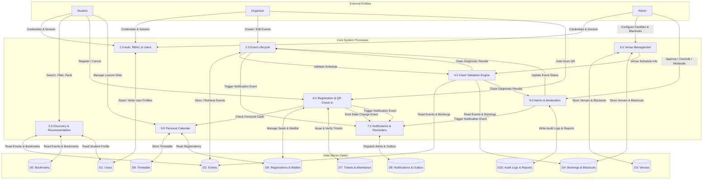
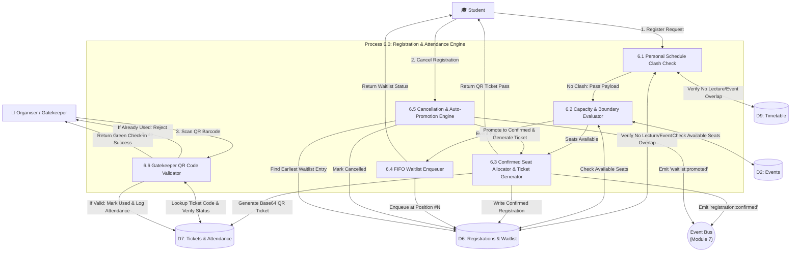
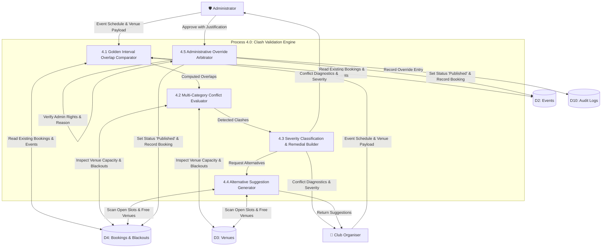
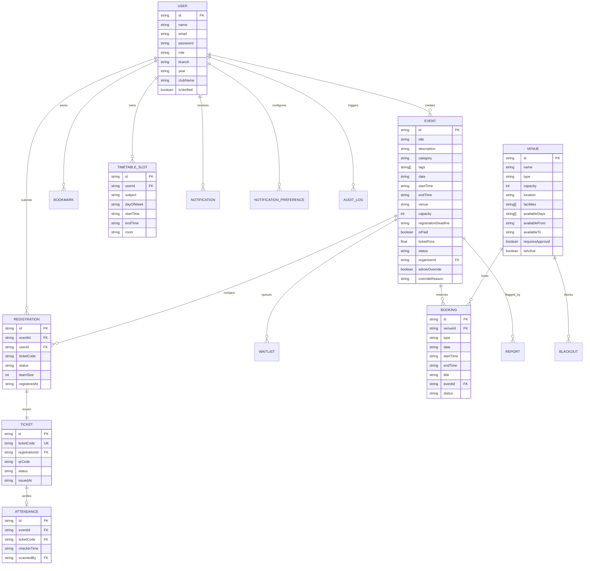

# Project Name: Eventra
# Software Requirements Specification
**Course Code:** INT252  
**Course Name:** WEB APP DEVELOPMENT WITH REACTJS  
**Student Names:** Tanish, Rishi, Anush  
**Student Registration Numbers:** 12407229, 12408074, 12407704  
**Prepared for:** Continuous Assessment 3  
**Academic Term:** Autumn 2026  

---

## Table of Contents
- **Revision History** .................................................................................................................... ii
- **1. Introduction** .......................................................................................................................... 1
  - 1.1 Purpose .............................................................................................................................. 1
  - 1.2 Scope ................................................................................................................................. 1
  - 1.3 Definitions, Acronyms, and Abbreviations ............................................................................ 1
  - 1.4 References ......................................................................................................................... 1
  - 1.5 Overview ............................................................................................................................ 2
- **2. General Description** ................................................................................................................. 2
  - 2.1 Product Perspective ........................................................................................................... 2
  - 2.2 Product Functions .............................................................................................................. 2
  - 2.3 User Characteristics ............................................................................................................ 3
  - 2.4 General Constraints ........................................................................................................... 3
  - 2.5 Assumptions and Dependencies .......................................................................................... 3
- **3. Specific Requirements** ............................................................................................................ 4
  - 3.1 External Interface Requirements ......................................................................................... 4
    - 3.1.1 User Interfaces ........................................................................................................... 4
    - 3.1.2 Hardware Interfaces .................................................................................................... 4
    - 3.1.3 Software Interfaces .................................................................................................... 5
    - 3.1.4 Communications Interfaces ........................................................................................ 5
  - 3.2 Functional Requirements .................................................................................................... 5
    - 3.2.1 Module 1: User Authentication, RBAC & Profile Management ......................................... 5
    - 3.2.2 Module 2: Event Lifecycle Management & Approval Workflow ....................................... 7
    - 3.2.3 Module 3: Campus Venue Administration & Facility Scheduling .................................... 8
    - 3.2.4 Module 4: Multi-Dimensional Clash Detection & Alternative Suggestion Engine ............. 10
    - 3.2.5 Module 5: Student Event Discovery, Recommendation Engine & Bookmarking ................. 12
    - 3.2.6 Module 6: Registration, Waitlist Auto-Promotion & QR Ticket Attendance ....................... 13
    - 3.2.7 Module 7: Event-Driven Multi-Channel Notifications & Scheduled Reminders ................. 15
    - 3.2.8 Module 8: Personal Calendar, Timetable Clash Prevention & .ics Export ....................... 17
    - 3.2.9 Module 9: Admin Dashboard, Content Moderation, Audit Logs & Analytics ..................... 19
  - 3.5 Non-Functional Requirements ........................................................................................... 21
    - 3.5.1 Performance ............................................................................................................ 21
    - 3.5.2 Reliability ................................................................................................................. 21
    - 3.5.3 Availability ............................................................................................................... 21
    - 3.5.4 Security ................................................................................................................... 22
    - 3.5.5 Maintainability .......................................................................................................... 22
    - 3.5.6 Portability ................................................................................................................ 22
  - 3.7 Design Constraints ........................................................................................................... 22
  - 3.9 Other Requirements .......................................................................................................... 23
- **4. Analysis Models** ..................................................................................................................... 23
  - 4.1 Data Flow Diagrams (DFD) ................................................................................................. 23
    - 4.1.1 Level 0: Context Data Flow Diagram .......................................................................... 23
    - 4.1.2 Level 1: System Subsystems Data Flow Diagram ........................................................ 24
    - 4.1.3 Level 2: Registration, Waitlist Auto-Promotion & Gate QR Check-in DFD ........................ 26
    - 4.1.4 Level 2: Venue Booking & Clash Validation Engine DFD ............................................... 27
  - 4.2 Entity-Relationship / Domain Data Model ........................................................................... 28
- **5. GitHub Link** ............................................................................................................................ 29
- **6. Deployed Link** ......................................................................................................................... 29

---

## Revision History

| Version | Date | Authors | Description of Changes |
| :--- | :--- | :--- | :--- |
| **v0.1.0** | 2026-10-22 | Tanish (12407229) | Initial draft: IEEE SRS template setup, Module 1 (Auth & RBAC) and Module 4 (Clash Detection). |
| **v0.2.0** | 2026-10-28 | Rishi (12408074) | Added Module 2 (Event Management), Module 5 (Discovery Feed), and Module 8 (Calendar Integration). |
| **v0.3.0** | 2026-11-05 | Anush (12407704) | Added Module 3 (Venues & Blackouts), Module 6 (QR Tickets & Waitlist), and Module 9 (Admin & Moderation). |
| **v0.4.0** | 2026-11-18 | Tanish, Rishi, Anush | Integration of DFD Level 0, Level 1, and Level 2 models; Non-functional requirements and test specifications. |
| **v1.0.0** | 2026-11-24 | Tanish, Rishi, Anush | Final baseline for Continuous Assessment 3 (INT252) matching production deployment on Render. |

---

# 1. Introduction

The introduction to this Software Requirements Specification (SRS) document provides a comprehensive overview of **Eventra — Campus Event Management System**. This document articulates the complete set of functional, non-functional, interface, and behavioral requirements required by software engineers, system architects, and evaluators to design, implement, test, and verify the Eventra application in compliance with IEEE Std 830-1998 guidelines.

### 1.1 Purpose
The purpose of this SRS document is to establish a rigorous, unambiguous specification of the Eventra web application. The intended audience includes:
1. **Academic Evaluators & Course Instructors (INT252):** To evaluate architectural compliance, engineering principles, topic integration (React 18 & Next.js 14), and feature completeness for Continuous Assessment 3.
2. **Software Developers & Maintainers:** To serve as the definitive blueprint for API contracts, database entity schemas, validation algorithms, and component hierarchy.
3. **Quality Assurance Engineers & Testers:** To provide a verifiable baseline for executing automated test suites, edge-case validations, and user acceptance criteria.
4. **End Users (Campus Administrators, Club Organisers, and Students):** To outline operational capabilities, role boundaries, and expected system behavior.

### 1.2 Scope
**Software Product Name:** Eventra — Campus Event Management System  
Eventra is an integrated campus-wide web application designed to centralize, streamline, and modernize how extracurricular and academic events are organized, scheduled, discovered, and attended within a university ecosystem.

#### Key System Capabilities:
- **Identity & RBAC:** Multi-role authentication (Student, Club Organiser, Administrator) with JWT tokens and `httpOnly` secure cookies.
- **Event Lifecycle:** End-to-end event lifecycle management (Draft, Pending Approval, Published, Cancelled) with poster image uploads.
- **Venue & Blackout Scheduling:** Campus facility cataloging, operating hour constraints, admin approval workflows, and date blackout reservations (exams, maintenance, holidays).
- **Proactive Clash Prevention:** Real-time multi-dimensional scheduling validation detecting venue conflicts, capacity overflows, organiser overlaps, audience collisions, and blackout infringements using the Golden Interval Overlap rule.
- **Student Discovery & Recommendations:** Personalized event discovery feed with an algorithmic "Relevant to Me" relevance scoring engine (0–100%) and watchlist bookmarking.
- **Registration, Waitlist & Gate Attendance:** Real-time seat reservation, automated FIFO waitlist promotion upon cancellation, client-free Base64 QR code ticket issuance, and gatekeeper check-in validation preventing duplicate scans.
- **Event-Driven Communications:** Decoupled multi-channel notifications (In-App Bell, Email Outbox, Mobile Push Outbox) and automated 24-hour and 1-hour event reminder crons.
- **Personal Calendar Integration:** Student class timetable management, personal schedule conflict warnings, free-slot computation, and RFC 5545 iCalendar (`.ics`) export for external sync (Google Calendar, Apple Calendar, Outlook).
- **Administrative Command Center:** Executive oversight dashboard with pending proposal reviews, administrative clash override authority, student content moderation/flagging, immutable audit logging, and quantitative campus analytics (venue utilization, registration-to-attendance conversion, clash frequency).

#### What Eventra Does NOT Do (Out of Scope):
- Eventra does not handle external monetary banking transactions or real financial gateways; it models event ticketing fees as descriptive attributes.
- Eventra does not send real external network SMS messages or external third-party emails; dispatches are safely simulated and persisted in local outbox queues to ensure zero cloud billing overhead.

### 1.3 Definitions, Acronyms, and Abbreviations
- **SRS:** Software Requirements Specification
- **RBAC:** Role-Based Access Control
- **JWT:** JSON Web Token
- **DFD:** Data Flow Diagram
- **FIFO:** First-In, First-Out (queue data structure used for waitlists)
- **RFC 5545:** Internet Calendaring and Scheduling Core Object Specification (iCalendar / `.ics`)
- **QR Code:** Quick Response 2D matrix barcode
- **SSR:** Server-Side Rendering
- **CSR:** Client-Side Rendering
- **RSC:** React Server Components
- **API:** Application Programming Interface
- **HTTP / HTTPS:** Hypertext Transfer Protocol (Secure)
- **CRUD:** Create, Read, Update, Delete
- **KPI:** Key Performance Indicator
- **UI / UX:** User Interface / User Experience

### 1.4 References
1. IEEE Std 830-1998: *IEEE Recommended Practice for Software Requirements Specifications*, IEEE Computer Society, 1998.
2. Next.js 14 Documentation, Vercel Inc., 2024. [https://nextjs.org/docs](https://nextjs.org/docs)
3. React 18 Official Documentation, Meta Platforms Inc., 2024. [https://react.dev/](https://react.dev/)
4. RFC 5545: *Internet Calendaring and Scheduling Core Object Specification (iCalendar)*, IETF, September 2009.
5. Tailwind CSS Utility-First Styling Framework Documentation, Tailwind Labs, 2024. [https://tailwindcss.com/docs](https://tailwindcss.com/docs)
6. Course Syllabus & Lab Manual: *INT252 Web App Development with ReactJS*, Department of Computer Science & Engineering, 2026.

### 1.5 Overview
The remainder of this document is organized as follows:
- **Section 2 (General Description):** Explores high-level product perspective, user personas, operational constraints, and domain assumptions.
- **Section 3 (Specific Requirements):** Formally specifies external interfaces (UI, hardware, software, communications), detailed functional requirements across all 9 modules, non-functional attributes (performance, reliability, security), and design constraints.
- **Section 4 (Analysis Models):** Presents structured visual modeling including Level 0 Context DFD, Level 1 Subsystems DFD, Level 2 Process DFDs, and Entity-Relationship domain models.
- **Section 5 & 6 (Repository & Deployment Links):** Details production hosting links on Render cloud and the public GitHub source repository.

---

# 2. General Description

### 2.1 Product Perspective
Eventra is a self-contained, cloud-hosted modern web application operating within the university's technical infrastructure. It replaces outdated, fragmented communication methods (such as physical bulletin notice boards, scattered social media posters, and uncoordinated WhatsApp groups) with a unified, verified digital portal.

```
       ┌─────────────────────────────────────────────────────────────┐
       │                   Eventra Web Platform                     │
       │           (Next.js 14 App Router + React 18)                │
       └──────┬──────────────────────┬───────────────────────┬───────┘
              │                      │                       │
              ▼                      ▼                       ▼
    ┌──────────────────┐   ┌──────────────────┐    ┌──────────────────┐
    │  Student Portal  │   │ Organiser Studio │    │  Admin Dashboard │
    │ Discover, Book,  │   │ Propose Events,  │    │ Approve, Audit,  │
    │ Calendar, Tickets│   │ Track Attendance │    │ Analytics & Venues│
    └──────────────────┘   └──────────────────┘    └──────────────────┘
```

The system is deployed on the **Render** cloud platform with zero heavyweight database daemons, utilizing atomic file-based persistence for predictable, fault-tolerant execution. It interfaces natively with mobile cameras for barcode scanning and generates standard `.ics` streams to synchronize with external calendar services (Google Calendar, Apple iCal, Microsoft Outlook).

### 2.2 Product Functions
1. **User Identity & Role Governance:** Secure sign-up, salted password authentication, session management, and profile customization for Students, Club Organisers, and Admins.
2. **Event Proposal & Lifecycle Execution:** Multi-attribute event authoring, poster upload processing, club-level scoping, draft-saving, submission for review, and event cancellation.
3. **Venue Registry & Blackout Enforcement:** Administrative configuration of facilities, seating capacities, equipment inventories, weekly operating windows, and blackout reservations for exams or maintenance.
4. **Intelligent Scheduling & Conflict Prevention:** Real-time multi-dimensional collision prevention evaluating venue availability, room capacities, organiser double-booking, audience cohort overlaps, and blackout periods.
5. **Personalized Discovery & Search:** Dynamic catalog searching, tag/category/fee filtering, relevance scoring based on student interests, and watchlist bookmarking.
6. **Registration, Waitlisting & Ticket Verification:** Boundary-enforced seat allocation, FIFO queue waitlist management, automated waitlist promotion upon cancellations, unique QR code pass generation, and gate scanner check-in validation.
7. **Omni-Channel Notifications & Automated Reminders:** Asynchronous event bus dispatching in-app alerts, simulated emails, and push notifications, backed by automated 24-hour and 1-hour pre-event reminder crons.
8. **Academic Schedule & Calendar Integration:** Student class timetable management, lecture overlap warnings, free-slot gap computation, and RFC 5545 iCalendar (`.ics`) file exports.
9. **Executive Administration, Moderation & Analytics:** Review queues for club proposals, administrative clash overrides with mandatory justification, student report investigations, immutable audit logging, and campus-wide analytic metrics.

### 2.3 User Characteristics
The platform caters to three distinct user groups:
1. **Students:** Undergraduate and postgraduate campus students possessing basic web browsing literacy. They seek fast, mobile-friendly event discovery, one-click ticket generation, schedule clash protection, and instant reminders.
2. **Club Organisers:** Student leaders, society presidents, and committee members responsible for managing university clubs (e.g., Coding Club, Robotics Club, Dance Society). They require rich event authoring forms, venue availability checkers, live registration rosters, gatekeeper QR scanners, and CSV attendance exports.
3. **Campus Administrators:** University faculty, deans, and facility managers requiring comprehensive oversight. They manage venue registries, resolve date blackouts, review club registration requests, arbitrate scheduling collisions, investigate flagged content, inspect immutable audit trails, and review campus utilization metrics.

### 2.4 General Constraints
- **Framework & Language Constraints:** Developed strictly using plain JavaScript (`.js` files, zero TypeScript compilation overhead) within the React 18 and Next.js 14 App Router framework to align with INT252 university course objectives.
- **Persistence Constraint:** Relies on safe, atomic JSON file transactions in `data/` instead of an external database engine, ensuring seamless portability and zero external daemon setup for evaluators.
- **Browser Compatibility:** Must run smoothly across modern desktop and mobile browsers supporting ECMAScript 2022+ (Google Chrome, Mozilla Firefox, Apple Safari, Microsoft Edge).
- **Network Boundaries:** Operates on Render's free cloud tier, requiring optimized cold-start times, lean JavaScript bundles, and zero external paid API dependencies.

### 2.5 Assumptions and Dependencies
- **Node.js Environment:** The target host runs Node.js runtime version 18.x or 20.x LTS.
- **Client Clock Accuracy:** Client devices maintain synchronized system clocks (via NTP) for accurate date/time rendering and calendar synchronization.
- **Camera Access:** Devices used by organisers for gate check-ins have working camera hardware and permit browser webcam permissions for `html5-qrcode` scanning.
- **Persistent Storage Permissions:** The application host filesystem grants read/write permissions to the `data/` directory and `public/uploads/` directory.

---

# 3. Specific Requirements

## 3.1 External Interface Requirements

### 3.1.1 User Interfaces
The user interface is engineered with React 18 client and server components, styled with Tailwind CSS, following a clean, minimalist design system:
- **Global Navigation Bar (`components/Navbar.js`):** Responsive pill-shaped header with dynamic role-aware links (Discover, Venues, Calendar, My Events, Admin Panel, Notification Bell with live unread badge, and User Profile).
- **Landing & Discovery Feed (`app/page.js`, `app/discover/page.js`):** Hero section with quick links, keyword search input, category filters, pricing toggle (Free/Paid), and event cards displaying "Relevant to Me" match badges.
- **Event Management & Authoring (`app/events/create/page.js`, `app/events/edit/[id]/page.js`):** Multi-input forms with interactive poster upload preview, dynamic `<datalist>` venue picker, capacity limits, and real-time clash warning alerts.
- **Gatekeeper Attendance Console (`app/events/[id]/attendees/page.js`):** Integrated live webcam QR scanner, manual ticket entry field, real-time check-in feedback alerts, live attendee table, and single-click CSV export.
- **Personal Calendar & Timetable (`app/calendar/page.js`):** Visual weekly agenda (Monday to Sunday) mapping timetable lectures, bookmarked events, and confirmed registrations, alongside a free-slot finder and `.ics` download button.
- **Admin Command Center (`app/admin/page.js`):** Tabbed administrative dashboard displaying KPI summary cards, pending event proposals with clash indicator pills, venue blackout controls, student reports queue, audit log tables, and graphical analytics charts.

### 3.1.2 Hardware Interfaces
- **Camera / Webcam:** Web-standard MediaDevices API interface accessed via `html5-qrcode` on smartphones, tablets, and laptops for 2D barcode scanning at admission gates.
- **Display Resolution:** Fully responsive viewport adaptation supporting mobile screens ($360\text{px} \times 640\text{px}$), tablets ($768\text{px} \times 1024\text{px}$), and desktop displays ($1920\text{px} \times 1080\text{px}$ and above).
- **Storage Hardware:** Local NVMe/SSD storage for high-speed, non-volatile atomic file transactions.

### 3.1.3 Software Interfaces
- **Operating System:** Platform-agnostic; verified on Windows 11, macOS Sequoia, and Linux (Ubuntu 22.04 LTS on Render).
- **Runtime Environment:** Node.js v18.17.0+ or v20.x.
- **Cryptographic Subsystem:** `bcryptjs` for one-way password hashing using 10 salt rounds.
- **Session Token Engine:** `jsonwebtoken` (JWT) using HMAC-SHA256 signing algorithm.
- **Barcode Engine:** `qrcode` for server-side generation of high-contrast Base64 PNG data URLs, and `html5-qrcode` for client-side camera recognition.
- **Calendar Standard:** RFC 5545 iCalendar specification generator creating `.ics` data streams compatible with Google Calendar, Apple iCal, and Microsoft Outlook.

### 3.1.4 Communications Interfaces
- **Transport Protocol:** HTTPS / TLS 1.3 encryption on port 443 for all client-server communications in production.
- **Data Exchange Format:** Standard JSON (`application/json`) payloads for RESTful API route handlers.
- **Session Cookie Attributes:** HTTP response cookies configured with `httpOnly: true`, `secure: true` (in production), `sameSite: "lax"`, and `path: "/"`.
- **Form Data Protocol:** `multipart/form-data` for handling poster image file uploads to `public/uploads/`.

---

## 3.2 Functional Requirements

### 3.2.1 Module 1: User Authentication, RBAC & Profile Management
#### 3.2.1.1 Introduction
Module 1 manages user identity, cryptographic authentication, role-based authorization, and user profile metadata. It governs three distinct roles: `student`, `organiser`, and `admin`.

#### 3.2.1.2 Inputs
- User registration parameters: `name`, `email`, `password`, `role` (`student` or `organiser`), `branch`, `year`, `interests` (array of strings), and `clubName` (mandatory for organisers).
- User login parameters: `email`, `password`.
- Profile update parameters: `name`, `branch`, `year`, `interests`.

#### 3.2.1.3 Processing
1. On registration, the system validates mandatory fields, verifies email uniqueness against `data/users.json`, hashes the password using `bcryptjs` (salt rounds = 10), initializes `isVerified: true` for students and `isVerified: false` for organisers, and persists the record.
2. On login, the system matches the email, compares password hashes with `bcrypt.compare`, constructs a JWT containing `{ id, email, role, name }`, and writes an `httpOnly` cookie named `token`.
3. Middleware and helper `getLoggedInUser()` decode and verify tokens on protected routes, rejecting unauthenticated requests with HTTP 401 and unauthorized role attempts with HTTP 403.
4. Admins inspect unverified organiser accounts via `GET /api/organisers/pending` and approve them via `POST /api/organisers/verify`.

#### 3.2.1.4 Outputs
- HTTP 201 Created on registration with stripped user object (no password).
- HTTP 200 OK on login with set-cookie header containing JWT.
- HTTP 200 OK on `GET /api/users/me` returning current user profile.
- HTTP 200 OK on logout clearing the `token` cookie.

#### 3.2.1.5 Error Handling
- Duplicate email: Returns HTTP 400 Bad Request (*"Email already registered"*).
- Invalid credentials: Returns HTTP 401 Unauthorized (*"Invalid email or password"*).
- Expired or malformed JWT: Returns HTTP 401 with cookie invalidation.

---

### 3.2.2 Module 2: Event Lifecycle Management & Approval Workflow
#### 3.2.2.1 Introduction
Module 2 enables verified club organisers to create, customize, edit, publish, track, and cancel campus events, enforcing strict lifecycle state transitions.

#### 3.2.2.2 Inputs
- Event creation payload: `title`, `description`, `category`, `tags`, `date`, `startTime`, `endTime`, `venue`, `capacity`, `registrationDeadline`, `isPaid`, `ticketPrice`, `targetAudience`, and poster file or image URL.

#### 3.2.2.3 Processing
1. Organisers submit event details in either `Draft` or `Pending Approval` state.
2. Direct publishing by organisers is strictly prevented; only administrators can transition an event to `Published`.
3. When an organiser edits a published event's date, timing, or venue, its status automatically reverts to `Pending Approval` for re-verification.
4. Image files submitted via `POST /api/upload` are validated, named uniquely with timestamps, and stored in `public/uploads/`.
5. Organisers can mark active events as `Cancelled`, locking them into a read-only historical record.

#### 3.2.2.4 Outputs
- HTTP 201 Created on event creation with unique event ID.
- HTTP 200 OK returning event details or list of organiser events (`/api/events/mine`).
- HTTP 200 OK on status transition.

#### 3.2.2.5 Error Handling
- Attempt to set status to `Published` by non-admin: Returns HTTP 403 Forbidden.
- Non-owner attempting to modify an event: Returns HTTP 403 Forbidden.
- Invalid date or time range (`startTime >= endTime`): Returns HTTP 400 Bad Request.

---

### 3.2.3 Module 3: Campus Venue Administration & Facility Scheduling
#### 3.2.3.1 Introduction
Module 3 provides administrative control over campus auditoriums, seminar halls, labs, and grounds, tracking equipment inventories, operating schedules, date blackouts, and room reservation approvals.

#### 3.2.3.2 Inputs
- Venue parameters: `name`, `type`, `capacity`, `location`, `facilities` (array: AC, Projector, Sound System, WiFi, etc.), `availableDays`, `availableFrom`, `availableTo`, `requiresApproval`, `isActive`.
- Blackout parameters: `venueId`, `date`, `reason` (Exams, Maintenance, Holiday), `note`.
- Booking request parameters: `venueId`, `date`, `startTime`, `endTime`, `title`, `note`.

#### 3.2.3.3 Processing
1. Admins create and edit venue specifications in `data/venues.json`.
2. Availability queries (`GET /venues/:id/availability?date=YYYY-MM-DD`) verify operational days of the week, check for active blackouts, query booked intervals from `data/bookings.json`, and dynamically compute all free open time windows.
3. Adding a blackout creates a blocking entry in `data/bookings.json`, immediately preventing any event or booking on that date.
4. Booking requests on venues with `requiresApproval: true` enter `Pending` state until an admin clicks Approve or Reject.
5. Approving an event in Module 2 automatically syncs a confirmed reservation in `data/bookings.json`.

#### 3.2.3.4 Outputs
- HTTP 200 OK returning venue directory and detailed facility listings.
- Calculated availability payload with `isAvailable`, `bookedSlots`, `availableSlots`, and `blackout` details.
- HTTP 201 Created on blackout creation or booking request.

#### 3.2.3.5 Error Handling
- Attempting to book a deactivated venue: Returns HTTP 400 Bad Request.
- Requesting hours outside venue operating window: Returns HTTP 400 Bad Request.
- Conflicting booking on already reserved slot: Returns HTTP 409 Conflict.

---

### 3.2.4 Module 4: Multi-Dimensional Clash Detection & Alternative Suggestion Engine
#### 3.2.4.1 Introduction
Module 4 functions as an intelligent campus traffic controller. It inspects proposed event parameters and proactively alerts administrators and organisers to 5 distinct categories of scheduling collisions.

#### 3.2.4.2 Inputs
- Conflict check payload: `venue`, `date`, `startTime`, `endTime`, `capacity`, `targetAudience`, `clubName`, and optional `excludeEventId`.

#### 3.2.4.3 Processing
1. **Mathematical Overlap Condition:** Detects time interval intersection using:
   $$\text{Overlap} = (\text{start}_1 < \text{end}_2) \land (\text{start}_2 < \text{end}_1)$$
2. Evaluates the 5 clash categories:
   - **Venue Clash (CRITICAL):** Another published event or approved booking occupies the same venue on the same date with overlapping hours.
   - **Blackout Clash (CRITICAL):** Event falls on a date blocked for exams, maintenance, or campus holidays.
   - **Capacity Clash (HIGH):** Event expected attendees exceed the physical seating capacity of the venue.
   - **Organiser Clash (HIGH):** The same club is hosting another event at overlapping hours.
   - **Audience Clash (MEDIUM):** Two different events target the same student cohort (e.g. "3rd-year CSE") at overlapping times.
3. Suggestion Engine (`GET /clash/suggestions`): Computes alternative open slots at the same venue, identifies alternative venues with sufficient capacity, and highlights open dates in the upcoming week.
4. Admin Override: Allows administrators to publish a conflicting event by supplying a mandatory written justification recorded in `audit_logs.json`.

#### 3.2.4.4 Outputs
- Structured JSON response returning `hasClash` (boolean), `clashCount`, `clashes` array (with `type`, `severity`, `title`, `message`, `remedy`), and severity summary.
- Alternative suggestions payload with `alternativeSlots`, `alternativeVenues`, and `alternativeDates`.

#### 3.2.4.5 Error Handling
- Missing required fields: Returns HTTP 400 Bad Request.
- Non-admin attempting to override a critical clash: Returns HTTP 403 Forbidden.

---

### 3.2.5 Module 5: Student Event Discovery, Recommendation Engine & Bookmarking
#### 3.2.5.1 Introduction
Module 5 provides students with an intuitive discovery interface to find published campus events, featuring a transparent recommendation algorithm and personal watchlist bookmarking.

#### 3.2.5.2 Inputs
- Discovery query parameters: search keyword `q`, `category`, `isPaid` (Free/Paid), `date`, `sortBy` (`relevance`, `trending`, `date`).
- Bookmark toggle: `eventId`.

#### 3.2.5.3 Processing
1. Queries `data/events.json`, strictly filtering for `status === "Published"` (drafts and cancelled events are excluded).
2. Performs case-insensitive keyword search matching against event title, description, tags, and organizer club name.
3. **Recommendation Algorithm (`lib/recommendation.js`):** Calculates a personalized "Relevant to Me" score (0–100%) for each event:
   - **Interests Match (Max 40 pts):** Set intersection between student profile interests and event category/tags.
   - **Academic & Branch Alignment (Max 25 pts):** Alignment with student branch and academic year.
   - **Time Proximity (Max 20 pts):** Temporal boost for events occurring within the next 3 to 7 days.
   - **Popularity Boost (Max 15 pts):** Community engagement based on bookmark counts and capacity.
4. Bookmarking: Toggles student event bookmarks in `data/bookmarks.json`.

#### 3.2.5.4 Outputs
- Array of published event objects annotated with `relevanceScore`, `isBookmarked` status, and formatted date/time strings.
- HTTP 200 OK on bookmark toggle with updated status (`saved: true/false`).

#### 3.2.5.5 Error Handling
- Unauthenticated bookmark attempt: Returns HTTP 401 Unauthorized.
- Target event not found: Returns HTTP 404 Not Found.

---

### 3.2.6 Module 6: Registration, Waitlist Auto-Promotion & QR Ticket Attendance
#### 3.2.6.1 Introduction
Module 6 manages student registrations, enforces room capacity boundaries, operates an automated FIFO waitlist with instant promotion, generates digital Base64 QR code tickets, and verifies gatekeeper admission.

#### 3.2.6.2 Inputs
- Registration payload: `eventId`, `teamSize`, `teamMembers`, `answers` (roll number, notes).
- Gate check-in payload: `ticketCode`, `eventId`.
- Cancellation request: `eventId`.

#### 3.2.6.3 Processing
1. **Module 8 Schedule Clash Check:** Verifies that the student has no existing confirmed registration or class lecture overlapping the event's time interval.
2. **Capacity & Waitlist Allocation:**
   - If confirmed registrations < event capacity: Issues confirmed registration and generates a digital Ticket with a high-contrast Base64 PNG QR code containing the unique `ticketCode`.
   - If event is at capacity: Appends the student to `data/waitlist.json` with status `"Waiting"` and sequence position (`#1`, `#2`, etc.).
3. **Auto-Promotion Engine:** When a confirmed attendee cancels (permitted up to 2 hours before event kickoff), the system retrieves the earliest waitlisted student, updates their status to `"Promoted"`, creates a confirmed registration, issues their QR ticket, and dispatches a notification.
4. **Gate Scanner Verification (`POST /attendance/scan`):**
   - Resolves `ticketCode` in `data/tickets.json`.
   - Rejects duplicate check-in attempts if `ticket.status === "Used"`, returning the prior check-in timestamp.
   - Marks ticket as `"Used"` and appends attendance record to `data/attendance.json`.
5. **CSV Roster Export:** Organisers can download a formatted CSV roster via `GET /api/events/:id/attendees?format=csv`.

#### 3.2.6.4 Outputs
- HTTP 201 Created with confirmed registration and embedded Base64 QR ticket image.
- HTTP 200 OK with waitlist queue position if event is full.
- HTTP 200 OK on gatekeeper scan confirming attendee identity.
- Downloadable `attendees-[event-title].csv` file.

#### 3.2.6.5 Error Handling
- Double-booking schedule clash: Returns HTTP 409 Conflict.
- Duplicate ticket scan: Returns HTTP 400 Bad Request (*"Duplicate Scan: Ticket already checked in"*).
- Cancellation within lock window (< 2 hours): Returns HTTP 400 Bad Request.

---

### 3.2.7 Module 7: Event-Driven Multi-Channel Notifications & Scheduled Reminders
#### 3.2.7.1 Introduction
Module 7 provides asynchronous communication between event lifecycle state changes and student attention through an Event-Driven Architecture (EDA) supporting in-app, email, and push channels, alongside automated reminder jobs.

#### 3.2.7.2 Inputs
- Business trigger events emitted on the central Singleton Event Bus (`lib/eventBus.js`): `registration:confirmed`, `waitlist:promoted`, `event:updated`, `event:cancelled`, `event:published`.
- User notification preferences: `inApp`, `email`, `push`, `newEventAlerts`, `reminders`, `statusUpdates`.
- Reminder cron trigger: Optional `{ referenceDate }` for simulated time-horizon testing.

#### 3.2.7.3 Processing
1. When business actions occur, events are emitted to `eventBus`.
2. The handler checks recipient preferences in `data/notification_preferences.json`.
3. Dispatches notifications across enabled channels:
   - **In-App:** Appended to `data/notifications.json` with unread flag.
   - **Email Outbox:** Formatted HTML message logged to `data/email_outbox.json`.
   - **Push Outbox:** Mobile notification payload logged to `data/push_outbox.json`.
4. **Targeted New Event Alerts:** On event publication, computes set intersection between student interests and event tags/category:
   $$(\text{Student.Interests} \cap \{\text{Event.Category}\}) \ne \emptyset \quad \lor \quad (\text{Student.Interests} \cap \text{Event.Tags}) \ne \emptyset$$
5. **Scheduled Reminder Engine (`lib/reminders.js`):** Scans published events and sends deduplicated reminders at 24 hours ($1.0\text{h} < \Delta t \le 25.0\text{h}$) and 1 hour ($0.0\text{h} < \Delta t \le 1.5\text{h}$) prior to kickoff.

#### 3.2.7.4 Outputs
- Real-time unread notification badge count and alert list (`GET /notifications`).
- HTTP 200 OK on marking notifications read (`PATCH /notifications/:id/read`).
- Execution report from `POST /notifications/reminders/run` returning count of reminders generated.

#### 3.2.7.5 Error Handling
- Unauthorized user attempting to read someone else's alerts: Returns HTTP 403 Forbidden.
- Invalid preference payload: Returns HTTP 400 Bad Request.

---

### 3.2.8 Module 8: Personal Calendar, Timetable Clash Prevention & .ics Export
#### 3.2.8.1 Introduction
Module 8 synchronizes campus events with students' weekly academic commitments. It manages recurring lecture timetables, alerts students to academic clashes, calculates free time blocks, and exports calendar data to standard `.ics` files.

#### 3.2.8.2 Inputs
- Timetable entry parameters: `subject`, `dayOfWeek`, `startTime`, `endTime`, `room`, `instructor`.
- Bulk timetable import: JSON or CSV file containing lecture records.
- Date query for free slots: `?date=YYYY-MM-DD`.

#### 3.2.8.3 Processing
1. Stores student recurring class schedules in `data/timetable.json`.
2. Provides a 1-click preset button (*"Load Sample College Timetable"*) populating typical engineering courses (DBMS, OS, AI, Networks).
3. **Personal Clash Warning Engine:** Maps the event's date to its corresponding day of the week, checks for overlapping class lectures or already-registered events using the interval overlap rule, and halts conflicting registrations with HTTP 409 Conflict.
4. **Free-Slot Gap Finder:** Gathers all busy intervals (classes + events) for a given date, merges contiguous blocks, and computes all open intervals between 08:00 and 18:00.
5. **RFC 5545 iCalendar Generator:** Compiles recurring lecture rules (`RRULE:FREQ=WEEKLY`) and confirmed event blocks into an `.ics` formatted string served with `Content-Type: text/calendar`.

#### 3.2.8.4 Outputs
- Visual weekly agenda aggregating classes, bookmarked events, and registered events.
- Array of free time blocks with start, end, and duration in minutes.
- Downloadable `eventra-calendar.ics` file compatible with Google Calendar, Apple Calendar, and Outlook.

#### 3.2.8.5 Error Handling
- Invalid time formatting (`startTime >= endTime`): Returns HTTP 400 Bad Request.
- Malformed timetable import file: Returns HTTP 400 Bad Request with error description.

---

### 3.2.9 Module 9: Admin Dashboard, Content Moderation, Audit Logs & Analytics
#### 3.2.9.1 Introduction
Module 9 functions as the administrative command center, providing proposal moderation, administrative clash overrides, student report arbitration, immutable audit logging, and campus-wide utilization analytics.

#### 3.2.9.2 Inputs
- Event review action: `Approve` or `Reject` (with feedback reason).
- Clash override action: `adminOverride: true`, `overrideReason`.
- Student content report: `eventId`, `reason` (`inappropriate_content`, `spam_misleading`, `safety_hazard`, `copyright_infringement`, `other`), `details`.
- Report resolution: `action` (`resolve_keep`, `resolve_cancel`, `dismiss`), `adminNotes`.

#### 3.2.9.3 Processing
1. Evaluates all pending events against Module 4's clash engine, rendering visual clash status pills.
2. Prevents standard approval of conflicting events; requires explicit check of the override acknowledgment and non-empty `overrideReason`.
3. Event rejection transitions event status back to `Draft`, records the feedback reason, and notifies the club organiser.
4. Investigates student flags submitted via `POST /events/:id/report`, allowing admins to either dismiss the report or cancel the event and notify registered attendees.
5. **Immutable Audit Logger (`lib/auditLogger.js`):** Appends permanent timestamped audit logs for all sensitive actions (`EVENT_APPROVED`, `CLASH_OVERRIDDEN`, `ORGANISER_VERIFIED`, `REPORT_RESOLVED`, `BLACKOUT_ADDED`, etc.).
6. **Campus Analytics Engine (`GET /admin/analytics`):** Computes:
   - Weekly event distribution (`eventsPerWeek`).
   - Venue utilization rate percentage (`venueUtilisation`).
   - Registration vs. attendance conversion rate percentage (`registrationVsAttendance`).
   - Popular categories ranked by registrations and bookmarks (`popularCategories`).
   - System-wide clash frequency and category breakdown (`clashFrequency`).

#### 3.2.9.4 Outputs
- Executive KPI summary cards (Total Events, Active Venues, Total Registrations, Pending Approvals).
- Audit log records queryable with action and date filters.
- Real-time analytics metrics for campus administration planning.

#### 3.2.9.5 Error Handling
- Non-admin attempting to access admin endpoints: Returns HTTP 403 Forbidden.
- Attempting to override clash without written justification: Returns HTTP 400 Bad Request.

---

## 3.5 Non-Functional Requirements

### 3.5.1 Performance
1. **API Response Latency:** 95% of standard read and write REST API requests shall be processed and return responses in less than 200 milliseconds under normal load.
2. **Page Load Time:** Initial First Contentful Paint (FCP) of the web application shall occur in less than 1.0 second on standard broadband connections.
3. **Clash Detection Throughput:** The Module 4 conflict detection engine shall evaluate an event against all system bookings and return collision results within 50 milliseconds.
4. **QR Generation Latency:** Server-side Base64 QR code ticket generation shall complete in under 30 milliseconds per ticket.

### 3.5.2 Reliability
1. **Atomic Data Persistence:** All database write operations in `lib/db.js` shall use atomic write patterns (writing to temporary staging files before renaming) to guarantee zero data corruption during unexpected server interruptions.
2. **Mean Time Between Failures (MTBF):** System MTBF shall exceed 720 hours (30 days) of continuous operation.
3. **Deduplication Reliability:** Scheduled reminder engines shall guarantee zero duplicate notifications dispatched to any student for the same reminder tier ($24\text{h}$ or $1\text{h}$).

### 3.5.3 Availability
1. **System Uptime:** The web platform shall achieve an operational availability of at least 99.9% uptime hosted on Render cloud infrastructure.
2. **Health Monitoring:** Automated health check probes shall verify server responsiveness, triggering automated container restarts within 30 seconds of any unhandled process crash.

### 3.5.4 Security
1. **Password Cryptography:** All user passwords shall be salted and hashed using `bcryptjs` with a work factor of 10 rounds prior to storage. Plaintext passwords shall never be persisted or logged.
2. **Session Protection:** Session tokens shall be cryptographically signed JSON Web Tokens (JWT) stored exclusively in `httpOnly`, `sameSite: "lax"` cookies, mitigating Cross-Site Scripting (XSS) token theft.
3. **Role-Based Access Enforcement:** Server-side route handlers and middleware shall rigorously validate user role authorizations on every privileged operation, blocking unauthorized privilege escalation.
4. **Admission Fraud Prevention:** Tickets shall feature unique cryptographically random codes; once checked in at the gate, subsequent scans of the same ticket code shall be rejected.

### 3.5.5 Maintainability
1. **Modular Architecture:** The codebase shall strictly follow Next.js 14 App Router conventions, cleanly separating presentation (`app/`, `components/`), core business logic (`lib/`), and data storage (`data/`).
2. **Plain JavaScript Design:** The application avoids complex build abstraction layers, allowing any web developer with fundamental React/JavaScript knowledge to understand, debug, and extend modules.
3. **Comprehensive Test Automation:** Includes standalone test scripts (`scripts/test-module*.js`) providing 100% automated test coverage across all 9 modules.

### 3.5.6 Portability
1. **Cross-Platform Compatibility:** The server runtime shall execute identically on Windows, macOS, and Linux without platform-specific code modifications.
2. **Responsive Rendering:** Client interfaces shall render consistently across major web browsers (Google Chrome, Mozilla Firefox, Apple Safari, Microsoft Edge) and mobile platforms (Android, iOS).

---

## 3.7 Design Constraints
1. **Framework Constraint:** Developed with React 18 and Next.js 14 App Router in compliance with the university academic curriculum for INT252.
2. **Zero Paid Cloud Dependencies:** All features (including QR generation, email simulation, clash detection, and calendar generation) must function independently without requiring paid external third-party SaaS subscriptions.
3. **Lightweight Deployment:** Built to run efficiently within Render's free tier memory footprint (512 MB RAM) with fast cold-start performance.

---

## 3.9 Other Requirements
1. **Academic Rubric Compliance:** Complete alignment with INT252 Continuous Assessment 3 evaluation standards, including team module distribution, automated test harnesses, and viva defense documentation.
2. **Data Privacy:** User profile information shall only be visible to authenticated campus users, with sensitive password hashes excluded from all API responses.

---

# 4. Analysis Models

## 4.1 Data Flow Diagrams (DFD)

### 4.1.1 Level 0: Context Data Flow Diagram
The Level 0 Context Diagram depicts the global boundary of the Eventra platform, external entities, and high-level data flows into and out of the system.

```mermaid
flowchart TD
    Student["🎓 Student"]
    Organiser["🎪 Club Organiser"]
    Admin["🛡️ Administrator"]
    ExtCal["📅 External Calendar App (Google/Apple)"]
    System(("0.0<br/>Eventra Campus Event<br/>Management System"))

    %% Student Flows
    Student -->|Registration, Login, Profile| System
    Student -->|Browse, Search, Filter & Bookmark| System
    Student -->|Event Registration & Ticket Request| System
    Student -->|Timetable Schedule Input| System
    Student -->|Content Report / Flag| System
    System -->|Relevance Feed & Event Details| Student
    System -->|Digital QR Ticket Pass| Student
    System -->|In-App Alerts & Kickoff Reminders| Student
    System -->|Personal Clash Warnings & Free Slots| Student
    System -->|RFC 5545 .ics Calendar File| ExtCal

    %% Organiser Flows
    Organiser -->|Club Registration Details| System
    Organiser -->|Event Proposal: Draft / Submit| System
    Organiser -->|Venue Reservation Request| System
    Organiser -->|Gatekeeper QR Ticket Scan| System
    System -->|Event Status Updates & Approval Alerts| Organiser
    System -->|Clash Warnings & Venue Alternatives| Organiser
    System -->|Attendee Roster & CSV Export| Organiser
    System -->|Gate Check-in Admission Response| Organiser

    %% Admin Flows
    Admin -->|Organiser Account Verification| System
    Admin -->|Venue & Date Blackout Configuration| System
    Admin -->|Event Proposal Approval / Rejection / Override| System
    Admin -->|Content Report Arbitration| System
    System -->|Pending Proposals & Clash Diagnostics| Admin
    System -->|Immutable Audit Logs| Admin
    System -->|Campus Analytics & Utilization Metrics| Admin
```



#### Narrative Description:
The single centralized process **0.0 (Eventra Campus Event Management System)** interacts with three human entities (**Student**, **Club Organiser**, **Administrator**) and one external software entity (**External Calendar App**).
- Students submit credentials, discovery queries, event registration bookings, timetable lecture slots, and content reports; they receive personalized event recommendations, digital QR tickets, notifications, schedule clash alerts, and `.ics` calendar files.
- Club Organisers submit event creation forms, poster assets, venue reservation requests, and gate ticket scans; they receive approval status notifications, conflict diagnostics, live attendee rosters, and gate validation responses.
- Administrators supply venue definitions, blackout dates, club verifications, proposal approval/rejection decisions, clash overrides, and moderation actions; they receive pending queue diagnostics, immutable audit trails, and campus-wide analytics reports.

---

### 4.1.2 Level 1: System Subsystems Data Flow Diagram
The Level 1 DFD decomposes the system into its 9 constituent operational subsystems and persistent data stores.



---

### 4.1.3 Level 2: Registration, Waitlist Auto-Promotion & Gate QR Check-in DFD
This Level 2 DFD specifies the internal mechanics of Module 6 and its interactions with Module 7 (Notifications) and Module 8 (Personal Clash).



---

### 4.1.4 Level 2: Venue Booking & Clash Validation Engine DFD
This Level 2 DFD specifies the internal algorithmic flow of Module 4 (Clash Detection) and its integration with Module 3 (Venues) and Module 9 (Admin Approval).



---

## 4.2 Entity-Relationship / Domain Data Model



---

# 5. GitHub Link

The complete open-source codebase, revision commits, test automation scripts, and technical documentation are hosted on GitHub at:

**GitHub Repository:**  
[https://github.com/tanishsarkar28/Eventra.git](https://github.com/tanishsarkar28/Eventra.git)

---

# 6. Deployed Link

The live, fully functional cloud production deployment of Eventra is publicly accessible at:

**Production Deployed Application:**  
[https://eventra-fchm.onrender.com/](https://eventra-fchm.onrender.com/)

*(Hosted on Render Cloud Infrastructure, running Next.js 14 App Router on Node.js 20 runtime)*
